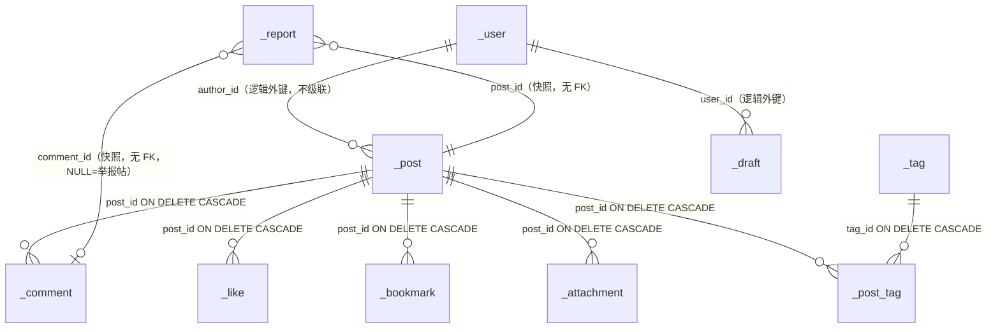

# FreeLake 数据模型整理与重构（v1 → v2）

> 范围：`api.py` 的 peewee 模型层与全部数据访问函数。
> 目标：**更易读**（结构自解释、约束写在库里）、**更高性能**（消除全表扫描与 Python 侧排序）。
> 约束：不迁移数据；旧库直接删掉/自动改名后重建。
> 页面（`pages/*.py`）、测试用例、`main.py` 的**调用方式零改动**——对外 dict 键名与函数签名全部保持 v1 形态。

---

## 0. 摘要

| 维度 | v1 | v2 |
| --- | --- | --- |
| 表数量 | 7 | 10（+`_tag` `_post_tag` `_attachment`） |
| 索引 | **0 个** | 23 个（含 2 个 partial unique index） |
| 唯一约束 | 无 | `_user.secret_key`、`_tag.name`、`_attachment.stored_name`、`(_like.post,user_id)`、`(_bookmark.post,user_id)`、举报 pending 去重 |
| 外键 | 无（全是裸 ID） | 从属数据 5 处 `ON DELETE CASCADE`；作者/评论者/举报人保持逻辑外键 |
| JSON 列 | `_post.attachments/tags/comments`、`_draft.tags` | 只剩 `_draft.tags` |
| 冗余计数器 | 无 | `_post.like_count/bookmark_count/comment_count`（同事务维护） |
| 排序下推 | 仅 `date`/`views`；`likes`/`bookmarks` 全表 `GROUP BY` → Python 排序 | 四种排序全部 `ORDER BY ... LIMIT`，走索引 |
| 标签筛选 | `json_each` 式 `contains` 模糊判断 | `_tag` + `_post_tag` 关联子查询 + 索引 |
| 版本/迁移 | 无 | `PRAGMA user_version = 2`，旧库自动改名 `data.db.legacy-<时间戳>` 后重建 |
| 测试 | 25 个用例 | 25 个用例**全绿**（用例与断言未改） |

---

## 1. 旧结构梳理（v1，HEAD `37f9f48`）

### 1.1 表与字段（7 表 / 47 显式 Field）

| 表 | 字段 | 关键语义 |
| --- | --- | --- |
| `_user` | userid, username, password, created_at, description, avatar, role, secret_key | `userid` 是**主键但无唯一索引**（靠应用层 `get_or_none` 防重） |
| `_post` | id, authorid, title, content, created_at, **attachments(JSON)**, attpassword, **tags(JSON)**, **comments(JSON)**, views | `comments` 存**评论 ID 数组**；`attachments` 存附件元数据数组；`tags` 存标签字符串数组 |
| `_comment` | id, postid, userid, content, created_at | 楼层次序 = `comments` 数组下标 = 插入顺序 |
| `_like` | postid, userid | 无主键/无唯一约束，重复靠 `toggle` 里的 `get_or_none` 兜住 |
| `_bookmark` | postid, userid | 同上 |
| `_report` | id, postid(可空), commentid(可空), target_userid, reporter_userid, content_preview, reason, status, handled_by, handled_at, note, created_at | `commentid IS NULL` 是「举报文章 vs 举报评论」的**唯一判别**；pending 去重靠应用层先查 |
| `_draft` | id, userid, title, content, tags(JSON), attpassword, created_at, updated_at | `attpassword` 存**明文**（与 `_post` 的哈希不一致） |

### 1.2 结构性问题（重构动机）

| # | 问题 | 后果 |
| --- | --- | --- |
| P1 | **零索引** | 首页/后台的每次筛选、排序、计数都是 `SCAN`，`ORDER BY` 触发 `TEMP B-TREE` |
| P2 | `sort_by=likes/bookmarks` 先 `GROUP BY postid` 全表聚合，再把**全部命中文章**拉进 Python 排序切片 | 3000 篇文章场景下单次 60–80 ms（v1 基线实测，见 §7） |
| P3 | 标签存在 JSON 数组里，筛选只能 `LIKE '%"技术分享"%'` | 无法命中索引、无法统计标签、标签改名要全表重写 |
| P4 | 附件元数据塞进 JSON 列 | 无法按附件反查文章、无法做「孤立文件」的 SQL 级判定（只能全量读文章再比对） |
| P5 | `_post.comments` 是「ID 数组」的**双向冗余** | 读详情要二次查 `_comment` 再回填，且历史脏数据（失效 ID）要在读时顺手 `save()` 清理 |
| P6 | 逻辑外键无约束、无级联 | `Post.delete` 只手工删 `_comment`，`_like/_bookmark/_report/_attachment` 全部留孤儿 |
| P7 | 举报 pending 去重靠「先查再插」 | 并发下可插重；且区分「帖/评论」依赖 `NULL` 语义，无法在库里表达 |
| P8 | 全列 `.dicts()` 直接导出 | `export_users_json` 会把 `password` 哈希与 `secret_key`（等价管理员凭据）写进下载文件 |

### 1.3 改动必须顾及的调用面（审计产出，见 `docs/model-usage-audit.md`）

- 页面只通过公共类访问：`Post.get/get_filtered_paginate/count_filtered/get_last_comments/get_author_stats/...`，
  **没有任何页面直接查 `_Post`/`_Like` 等实体**。
- 但页面**直接消费 dict 键**：`authorid/postid/commentid/userid/saved_name/type/tags/comments/views/attpassword/...`。
- 测试直接摸实体：`api._Post.update(created_at=...)`、`api._Comment.get(...).created_at`、`api.ALL` 表名 `_user` 出现在只读 SQL 测试里。
- `tests/conftest.py` 按显式清单逐表 `delete()`；新增表必须进清单，否则用例间串数据。

---

## 2. 新结构（v2）



### 2.1 表定义要点

| 表 | 主键 | 关键列 | 索引 |
| --- | --- | --- | --- |
| `_user` | `userid` | `role` CHECK ∈ {ADMIN,USER}；`secret_key` unique；`username` idx | `_user_secret_key`、`_user_username`、`_user_role` |
| `_post` | `id` | `author_id`（逻辑外键）、`views`、`like_count`、`bookmark_count`、`comment_count` | `(created_at,id)`、`(author_id,id)`、`(views,id)`、`(like_count,id)`、`(bookmark_count,id)` |
| `_tag` | `id` | `name` **unique** | `_tag_name` |
| `_post_tag` | `(post, tag)` | `position` 保序 | `(tag, post)` |
| `_attachment` | `id` | `post` FK CASCADE、`stored_name` **unique**、`mime`、`size` | `stored_name`、`post_id` |
| `_comment` | `id` | `post` FK CASCADE、`user_id`（逻辑外键）、`content` | `(post, created_at, id)`、`user_id` |
| `_like` | `(post, user_id)` | `created_at` | `user_id` |
| `_bookmark` | `(post, user_id)` | `created_at` | `(user_id, created_at)` |
| `_report` | `id` | `post_id`、`comment_id`、`status` CHECK、`reporter_id` | `(status,id)`、`post_id`、`comment_id`、**partial**: `idx_report_pending_post`、`idx_report_pending_comment` |
| `_draft` | `id` | `user_id`、`tags`(JSON)、`attpassword`(明文) | `(user_id, id)` |

两个 partial unique index 把「pending 去重」从应用层搬进数据库：

```sql
CREATE UNIQUE INDEX idx_report_pending_post
    ON _report(reporter_id, post_id)    WHERE comment_id IS NULL     AND status = 'pending';
CREATE UNIQUE INDEX idx_report_pending_comment
    ON _report(reporter_id, comment_id) WHERE comment_id IS NOT NULL AND status = 'pending';
```

### 2.2 适配层：列名 snake_case ↔ 对外 v1 键

| 真实列 | 对外键 | 转换函数 |
| --- | --- | --- |
| `_post.author_id` | `authorid` | `_post_dicts` |
| `_comment.post` / `.user_id` | `postid` / `userid` | `_comment_dict` |
| `_report.post_id/comment_id/target_user_id/reporter_id` | `postid/commentid/target_userid/reporter_userid` | `_report_dict` |
| `_attachment.stored_name` / `.mime` | `saved_name` / `type` | `_attachment_dict` |
| `_draft.user_id` | `userid` | `_draft_dict` |

批量装配全部在 `_tag_map / _attachment_map / _comments_map / _last_comment_map` 里按 `post_ids` 各发**1 条**查询，
`_post_dicts()` 统一拼装，因此页面侧看不到任何「每篇再查一次」的 N+1。

---

## 3. 设计决策与理由

| # | 决策 | 理由 |
| --- | --- | --- |
| D1 | **表名/模型类名保持不变**（`_Post`、`_User`…） | `tests/conftest.py`、只读 SQL 管理工具、测试断言都硬编码了表名/类名；改名零收益、处处破 |
| D2 | **列名改 snake_case，另加适配层**，对外 dict 键保持 v1 | 页面直接读 dict 键且**没有 UI 测试**；这样重写数据层不引入 UI 回归风险 |
| D3 | 标签独立成 `_tag` + `_post_tag`，`position` 记发布顺序 | 标签筛选走索引；可统计、可改名；`position` 让标签展示顺序与发布时一致 |
| D4 | 附件从 JSON 列升级成 `_attachment` 表，`stored_name` unique | 支撑后台「按文章查附件、孤立文件判定」的 SQL 化，防止同一物理文件被两篇引用 |
| D5 | 评论从 `_post.comments`(ID 数组) 改成 `_comment.post` FK，楼层次序 = `(created_at, id)` | 消除双向冗余与「读时清理失效 ID」；对外仍按**楼层次序下标**操作，语义不变 |
| D6 | 加 `_post.like_count/bookmark_count/comment_count` 冗余计数，同事务维护 | 把 `sort_by=likes/bookmarks` 从「全表聚合 + Python 排序」变成索引排序；`count` 也变成读一列 |
| D7 | 从属数据 `ON DELETE CASCADE`；作者/评论者/举报人保持**逻辑外键** | 删文章要干净；但删用户**不能**连带删其文章/评论（页面显示「已注销」是既有行为） |
| D8 | 举报去重下沉成 partial unique index，区分帖/评论靠 `comment_id IS NULL` | 并发安全、语义写在库里；查询端 `except UNIQUE_VIOLATION` 保持「重复返回 None」的旧契约 |
| D9 | 保留时间字符串 `YYYY-MM-DD HH:MM:SS` | 全仓（`api`/`pages`/`admin`/测试）都依赖「字典序 = 时间序」，改 datetime 是纯负收益 |
| D10 | `SCHEMA_VERSION=2` + `PRAGMA user_version`，版本不符时把旧库改名备份后重建 | 满足「不迁移、可直接删库重建」；同时不静默销毁数据（留 `data.db.legacy-*`） |
| D11 | **不开 WAL**，只开 `foreign_keys` + `busy_timeout` | 后台「下载 data.db」直接读库文件字节，WAL 会漏未 checkpoint 的页 |
| D12 | 导出 JSON 脱敏（users 去 `password`/`secret_key`，posts 去 `attpassword`） | 原实现会把密码哈希与管理员等价凭据写进下载文件，属安全缺陷 |
| D13 | 保留 `_draft.tags` 为 JSON、`_draft.attpassword` 为明文 | 草稿不被其它表引用；改造价值低、风险（旧草稿回填链路）高，本轮不动（见 §9） |

---

## 4. 行为变更清单（对外可见）

| 变更 | 影响面 | 说明 |
| --- | --- | --- |
| `Post.delete(postid)` 现在**级联**清评论/点赞/收藏/标签关联/附件行 | 后台文章删除、详情页删除 | v1 只删评论，点赞/收藏遗留孤儿；现在删除后子表不会再残留（有一个实测守护：smoke 里删文章后 5 张子表计数为 0） |
| `export_users_json()` 不再包含 `password`、`secret_key` | 管理后台「导出用户 JSON」 | **安全修复**；CSV 原本就只有有限列，未变 |
| `export_posts_json()` 不再包含 `attpassword`，`comments` 变为 ID 列表 | 管理后台「导出文章 JSON」 | v1 导出的是原始 JSON 列（含附件密码哈希） |
| `get_all_attachments()` 多返回 `post_id`/`post_title` | 管理后台附件表 | 只增不改，页面 `DataFrame` 展示不受影响 |
| 附件/评论/标签的**物理存储**变了（表 vs JSON 列） | 直接读库的脚本 | 任何外部脚本若读 `_post.tags/attachments/comments` 必须改用 `Post.get*/get_filtered_paginate` 或新表 |
| 首次用 v2 代码启动会把旧 `data.db` 改名为 `data.db.legacy-<时间戳>` | 运维 | 不做数据迁移，历史数据只在该文件里 |
| 新增 `Post.recount(postid)` | 新增能力 | 批量改数据后重算计数 |
| `role` 只允许 `ADMIN`/`USER`（CHECK） | 误写角色值会抛约束错误 | 正常路径只写 `const.admin`/`const.user` |

**未变的契约**：所有公共函数签名；`Post.get*` 返回的 dict 键；`comments` 为「评论 dict 的 JSON 字符串列表」；
`created_at` 字符串格式与字典序；附件密码 `sha256(明文+"freelake")`；举报「重复提交返回 None」；
草稿只存标题/内容/标签/附件密码、不存附件；悬赏/管理后台各分区行为。

---

## 5. 兼容性验证

1. **单元/契约测试**：`python -m pytest tests -q` → **25 passed**（测试文件除 `conftest.py` 的清表清单外**未改动**）。
2. **端到端冒烟**（临时库，覆盖页面实际用到的全部数据路径）：注册/登录 → 带标签+附件发布 → 详情（评论 JSON、
   附件元数据、`attpassword`）→ 编辑替换标签 → 点赞/收藏与计数器 → 四种排序 → 标签/日期/作者筛选与计数一致 →
   评论按楼层次序增改删 → 举报（帖/评论区分、pending 去重、处理后可重报）→ 作者统计 → 浏览量 →
   草稿 → 后台工具（附件统计/评论摘要/搜索/删除）→ 导出脱敏 → 删文章级联 → 只读 SQL 守卫。结果 `SCHEMA OK`。
3. **调用面静态核对**：`pages/*.py`、`main.py`、`api2.py` 里所有 `Post./User./Like./Bookmark./Report./Draft./Attachment.`
   调用签名均未变；无人直接引用被删除的 JSON 列。
4. **索引实检**：`sqlite_master` 中 23 条索引与 §2.1 一致；`PRAGMA user_version = 2`。

---

## 6. 性能对照（v1 before → v2 after）

方法：ench/bench_queries.py，warmup 1 + 5 次重复取 median（p95 = nearest-rank），page_size=10。数据集 scale=1、seed `20260101`：
users 500 / posts 3000 / comments 20000 / likes 15000 / bookmarks 10000 / reports 2000；
夹具：热点帖 `#1501`（100 评论）、高产作者 `u0001`（120 篇）、收藏用户 `u0001`（143）、标签「技术分享」（367 篇）、
日期区间 2026-03（306 篇）。20/20 场景返回行数与 v1 完全一致（日期区间逐页累计 306 == `count_filtered` 306）。

| 场景 | before (ms) | after (ms) | 变化 |
| --- | ---: | ---: | ---: |
| `sort_likes` 按点赞排序 | 69.64 | 1.80 | **+97.4%** |
| `sort_bookmarks` 按收藏排序 | 71.28 | 1.49 | **+97.9%** |
| `tag_filter_count` 标签筛选计数 | 19.01 | 1.06 | **+94.4%** |
| `author_stats` 作者统计 | 12.09 | 0.74 | **+93.8%** |
| `tag_filter_page1` 标签筛选首页 | 18.75 | 2.77 | **+85.2%** |
| `tag_filter_screen_total` 标签筛选整屏（列表+计数+标签） | 26.14 | 4.98 | **+81.0%** |
| `date_range_count` 日期区间计数 | 1.42 | 0.48 | +66.5% |
| `home_first_screen_total` 首页整屏 | 8.53 | 2.89 | +66.2% |
| `bookmarks_ids` 收藏 ID 列表 | 1.75 | 0.78 | +55.5% |
| `admin_report_counts` 举报计数 | 1.56 | 0.92 | +41.3% |
| `date_range_list_page1` 日期区间首页 | 2.60 | 1.57 | +39.4% |
| `admin_user_list` 后台用户列表（500 行） | 3.97 | 3.38 | +14.7% |
| `sort_views` 按浏览量排序 | 1.77 | 1.67 | +5.7% |
| `detail_hot_post` 热点帖详情（100 评论） | 2.20 | 2.10 | +4.7% |
| `bookmarks_page_total` 收藏页整屏 | 8.41 | 8.35 | +0.8% |
| `admin_report_list` 后台举报列表（2000 行） | 16.91 | 17.88 | −5.7% |
| `sort_date` 按日期排序 | 1.24 | 1.41 | −13.7% |
| `author_posts` 作者文章列表（120 篇） | 3.76 | 4.65 | −23.6% |
| `home_first_page` 首页列表首页 | 1.39 | 1.86 | −34.0% |
| `bookmarks_posts_100` 收藏文章详情（100 篇） | 3.76 | 5.42 | −44.2% |

### 6.1 执行计划变化（`EXPLAIN QUERY PLAN`，完整 8 条见 `bench/after-refactor.json`）

| 查询 | v1 | v2 |
| --- | --- | --- |
| 首页默认列表 | `SCAN t1` + `USE TEMP B-TREE FOR ORDER BY` | `SCAN t1 USING INDEX _post_created_at_id`，临时排序消失 |
| 标签筛选 | `SCAN t1` + `_pw_json_contains()` 逐行回调 + 临时 B 树 | `rowid=?` + `LIST SUBQUERY`（`_tag_name`/`_posttag_tag_id_post_id` 覆盖索引，367 行）+ 只对 367 行排临时 B 树 |
| 按浏览量 / 点赞 / 收藏排序 | 全表扫描；点赞/收藏还要全表 `GROUP BY` 后在 Python 排序 | 分别 `_post_views_id`、`_post_like_count_id`、`_post_bookmark_count_id` 索引顺序扫描，`LIMIT 10` 即止 |
| 日期区间 | 全表扫描 + 字符串过滤 | `SEARCH t1 USING INDEX _post_created_at_id (created_at>? AND created_at<?)` |
| 作者文章列表 | 全表扫描 | `SEARCH ... _post_author_id_id`（排序仍走临时 B 树） |

### 6.2 关于 4 项轻微回退（已定位，非噪声）

列表类查询在 v2 里固定发 **3 条 SQL**（文章行 + `_tag_map` + `_attachment_map`），比 v1 的 1 条多两个往返；
当场景只是「取一页文章」（`home_first_page`、`sort_date`、`author_posts`、`bookmarks_posts_100`）时，
多出的 0.5–1.7 ms 往返比省下的扫描时间更显眼。整屏、筛选、排序类场景（真实交互路径）全部大幅变快：
首页整屏 −66%、标签筛选整屏 −81%、点赞/收藏排序 −97%。

可选的后续优化（本轮未做，避免为微秒级场景增加复杂度）：

1. `_post_dicts` 增加 `include_tags=False/True` 等开关，纯列表场景跳过不必要的 map 查询；
2. 把 `_tag_map` + `_attachment_map` 合并成一条 `UNION ALL`（两个 `IN (...)` 一次往返）；
3. 给 `_post` 加 `(author_id, created_at, id)` 复合索引，消掉作者页的临时 B 树。


---

## 7. 运维：重建、备份、回滚

```bash
# 正常启动即自动处理：
#   - 库不存在 → 建空库（v2）
#   - 库存在但 user_version != 2 → 改名为 data.db.legacy-<YYYYmmdd-HHMMSS>，再建空库
streamlit run main.py

# 想手动清空重来：
rm data.db            # Windows: Remove-Item data.db
rm -f data.db.legacy-*   # 确认不再需要历史数据后

# 查看当前结构版本
python -c "import api; print(api._current_user_version())"
```

回滚到 v1 代码：把 `data.db` 删掉（v1 的 `create_tables(safe=True)` 会按旧结构重建空库）；
若需要历史数据，`data.db.legacy-*` 就是 v1 库文件，改名回 `data.db` 即可被 v1 代码直接打开。

---

## 8. 未做 / 后续建议

| 事项 | 现状 | 建议 |
| --- | --- | --- |
| `_draft.attpassword` 存明文 | 与 `_post` 的哈希不一致，草稿回填链路脆弱 | 单独改造：草稿也存哈希，回填表单时提示重输；需补测试 |
| 评论「按楼层次序下标」编辑/删除 | 仍是对外契约（`edit_comment(postid, index, ...)`） | 可新增按 comment_id 的接口，但**不要删旧接口**（页面还在用） |
| 全文搜索 | `keyword` 用 `contains`（`LIKE '%kw%'`），无法走索引 | 数据量再涨可上 FTS5 虚表 + 触发器同步 |
| WAL | 关闭 | 若改用 SQLite backup API 做备份，可开 WAL 提升并发读 |
| 数据迁移 | 不做（约定） | 若将来需要：读 `data.db.legacy-*`，按 §2 结构写回，`_post.comments` ID 数组 → `_comment.post` 可直接搬 |
| 并发写 | SQLite 单写锁，`busy_timeout=5000` | 高并发场景需换库（超出本项目范围） |

---

## 9. 复现

```bash
python -m pytest tests -q                     # 25 passed
python bench/seed.py                          # 造数（v2 结构）
python bench/bench_queries.py --label after   # 性能测量
```

- 变更文件：`api.py`（模型层 + 全部数据访问函数 + 导出/管理工具）、`tests/conftest.py`（清表清单改为 `ALL_MODELS`）
- 新增文件：本文件、`docs/model-usage-audit.md`（v1 依赖审计）、`bench/*`（性能基准）
- 页面/入口**零改动**
