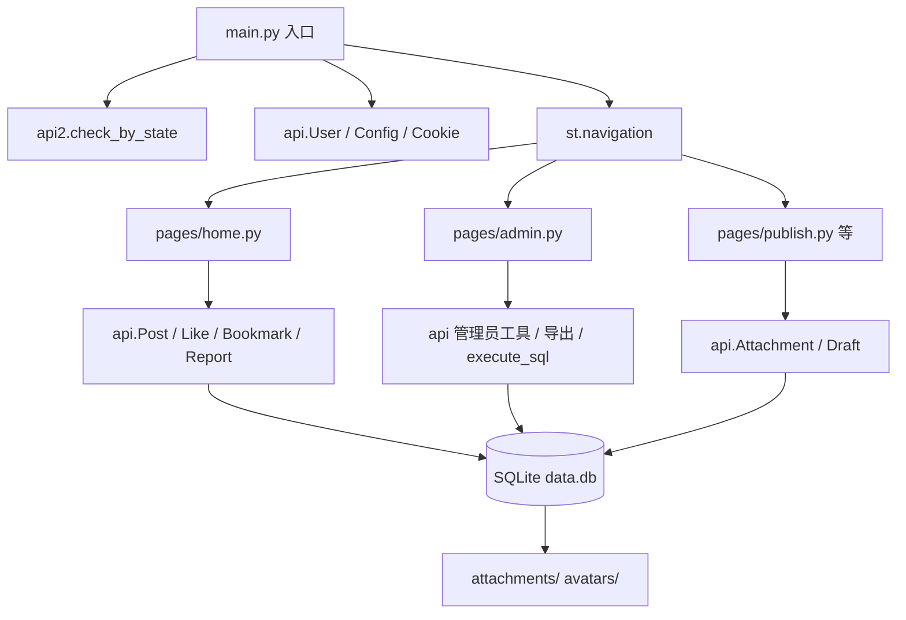

# v2 重构计划：项目结构分析与目标架构

> 分析对象：`freelake/`（v3 数据模型 + Streamlit 页面版，HEAD `5dbccbd`）
> 目的：把现有实现整体迁入 `v2/`，在 `v2/` 中重做**数据库模型（第一优先）**与**界面布局（第二优先）**；`v1/` 保留为上一代参考。
> 本文是重构前的结构梳理与目标设计，实施进度见文末「里程碑」。

---

## 1. 现状总览

| 文件 | 行数 | 职责 |
| --- | ---: | --- |
| `api.py` | 2238 | 数据层 + 安全 + 模型 + 适配 + 导出 + 管理员工具 + 启动引导（**单一文件承担 8 类职责**） |
| `main.py` | 218 | 入口：`set_page_config`、加密 Cookie、登录态恢复、深色 CSS hack、移动端 CSS、页面注册、导航装配、页脚 |
| `api2.py` | 25 | 会话判定 `check_by_state()` |
| `const.py` | 35 | 标签常量、角色常量 |
| `pages/home.py` | 905 | 首页列表 / 文章详情 / 个人主页 **三个路由合一** |
| `pages/admin.py` | 620 | 管理后台（9 个区块，全部在模块级执行） |
| `pages/image_generate.py` | 207 | AI 文生图（管理员） |
| `pages/publish.py` | 148 | 发布 + 草稿箱 |
| `pages/bookmarks.py` | 54 | 我的收藏 |
| `pages/login.py` / `register.py` / `logout.py` | 44 / 66 / 21 | 认证 |
| `tests/` | 66 + 768 | 仅覆盖数据层（35 个用例），无 UI/会话测试 |
| `bench/` | 1297 | 性能基准（seed + 20 条热路径），独立于应用运行 |
| `static/` | 4.5MB | 视频背景等静态资源 |
| `v1/` | 256KB | 上一代实现（参考，不再维护） |

运行期数据（gitignored）：`data.db`、`data.db.legacy-*`、`attachments/`、`avatars/`、`.streamlit/secrets.toml`。

---

## 2. 模块归类（按职责）

### 2.1 入口与编排层
- `main.py`：应用边界。职责过载：全局配置 + 认证中间件 + 主题注入 + 路由装配 + 页脚。

### 2.2 会话/认证层
- `api2.py` → `check_by_state()`（每次 rerun 查库校验 userid+password）。
- 相关逻辑散落：`api.User.login/issue_secret_key/check_admin`、`main.py` 的 Cookie 读写、`pages/login|register|logout`。
- 问题：Cookie 里存**明文密码**（加密后）与 secretkey；会话状态无独立实体，无法撤销单个会话。

### 2.3 数据层（`api.py`，按 region 拆分）
| region | 位置 | 职责 |
| --- | --- | --- |
| 安全工具 | 79–226 | `execute_sql` + SQLite authorizer、`mask_sensitive_rows`、`format_size`、`generate_sk_key` |
| 模型 | 228–466 | 10 张 peewee 表（`_user/_post/_tag/_post_tag/_attachment/_comment/_like/_bookmark/_report/_draft`） |
| 适配层 | 469–640 | 行 → 对外 dict（v1 键名兼容：`authorid/postid/saved_name/...`） |
| 配置/凭据 | 643–780 | `Config`、`admin_credentials`、PBKDF2、密码校验缓存 |
| 库初始化 | 780–850 | CWD 相对 `data.db`、旧库归档重建、partial unique index、`user_version` |
| 业务接口 | 853–1891 | `User/Post/Attachment/Like/Bookmark/Report/Draft` 六个「表 + 业务」混合类、头像处理 |
| 导出 | 1894–2015 | 用户/文章/评论 × CSV/JSON（含脱敏） |
| 管理员工具 | 2018–2238 | 附件统计与清理、评论摘要/搜索、孤立数据、公告引导 |

**结构问题**：模型定义、SQL 查询、业务规则、导出、后台工具全在一个模块；表级职责（`Post` 类 274 行）与用例级逻辑混在一起；任何改动都要读 2000 行文件。

### 2.4 表现层（`pages/`）
- 三个页面（list/detail/profile）挤在 `home.py`；管理后台 620 行模块级脚本；重复的「文章卡片 / 附件列表 / 评论列表」渲染逻辑没有组件化。
- CSS 依赖 `data-testid` 的深色模式 hack（`main.py:96-171`）与移动端媒体查询，和业务代码混在入口。
- 所有页面依赖「模块级执行」的 Streamlit 模型，函数化/组件化程度低。

### 2.5 资源与配置
- `static/`（视频背景）、`pages/logo.ico`、`default_avatar.jpeg`。
- `.streamlit/config.toml`（主题 + server）、根 `config.toml`（管理员兜底）、`.streamlit/secrets.toml`（真实密钥，gitignored）。
- 问题：数据库路径与附件路径的基准不同（CWD vs `__file__`），换目录启动会"丢数据"。

### 2.6 测试 / 基准 / 文档
- `tests/`：35 个数据层用例，UI、会话、管理后台动作无覆盖。
- `bench/`：可复现基准，但结果 JSON 写死本机绝对路径。
- `AGENT.md` + `docs/`：交接文档、模型重构报告、项目审查报告。

---

## 3. 依赖与调用流



特点：入口 → 页面 → `api` 单点；页面之间没有共享组件；会话判定在入口与页面各调一次。

---

## 4. 现有数据模型（v3）的问题清单

| # | 问题 | 影响 |
| --- | --- | --- |
| D1 | 无会话表：Cookie 里存明文密码 + secretkey | 凭据泄露面大、无法撤销单个会话、改密才能踢下线 |
| D2 | 举报用 `post_id/comment_id` 可空对表达多态目标 | 语义靠 NULL 推断；新增举报类型要改索引和查询 |
| D3 | 作者/评论者/举报人/草稿主是「逻辑外键」 | 删用户后内容引用悬空，只能靠 UI 显示"已注销" |
| D4 | 计数器（like/bookmark/comment）手工维护 | 任一写路径漏改就漂移，且没有对账入口 |
| D5 | `_draft.tags` 仍是 JSON | 与其他标签关系不一致 |
| D6 | 无 `updated_at`（文章/评论/用户） | 无法展示"已编辑"，也无法做增量同步 |
| D7 | `_tag` 无使用计数 | 标签云/排序要全表 group by |
| D8 | `_attachment` 无内容哈希/图片标记 | 无法校验文件完整性、无法做去重与图片筛选 |
| D9 | 无审计日志 | 管理员动作（删帖/删评论/改角色）不可追溯 |
| D10 | 表名沿用 v1 的 `_user/_post/...` | 前缀无意义，和 v2 的整洁命名不一致 |
| D11 | 时间字段是本地时间字符串、无时区 | 跨时区/夏令时排序漂移 |
| D12 | 初始化/索引/升级逻辑混在 `api.py` | 结构演进不可测、不可复用 |

---

## 5. v2 目标架构

```
v2/
├── app.py                        # 唯一入口：page_config + 布局 + 导航
├── freelake/
│   ├── __init__.py
│   ├── settings.py               # BASE_DIR 锚定、secrets/env/config、常量
│   ├── constants.py              # 标签、角色、分页等
│   ├── security.py               # 密码、会话 token、只读 SQL、脱敏
│   ├── db/
│   │   ├── connection.py         # engine + pragmas + 事务工具
│   │   ├── models.py             # 13 张表（表名去前缀、语义清晰）
│   │   ├── schema.py             # 建表/索引/版本/旧库归档
│   │   └── serialize.py          # 行 → dict（保持页面契约）
│   ├── repos/                    # 每张聚合一个数据访问模块（无 UI 依赖）
│   │   ├── users.py  sessions.py  posts.py  comments.py
│   │   ├── tags.py   attachments.py  reactions.py  reports.py  drafts.py
│   ├── services/                 # 用例编排（跨 repo）
│   │   ├── auth.py  publishing.py  moderation.py  exports.py  maintenance.py
│   └── web/
│       ├── layout.py             # 主题/CSS/页头页脚（从 main.py 抽出）
│       ├── nav.py                # 导航装配
│       ├── components/           # post_card / comment_thread / attachment_list / pagination / forms / dialogs
│       └── views/                # feed / post_detail / profile / publish / bookmarks / admin / auth / image_gen
├── tests/                        # 数据层 + 组件（用 Streamlit AppTest）
├── static/  .streamlit/config.toml  requirements.txt  README.md
```

原则：
1. **依赖单向**：`web → services → repos → db`；`db` 不 import streamlit。
2. **兼容 facade**：`v2/api.py` 保留为薄门面（re-export），页面可逐页迁移，不被一次性大爆炸阻塞。
3. **不迁移旧数据**：`SCHEMA_VERSION` 提升，旧库自动归档 `data.db.legacy-*`。
4. **页面契约稳定**：对外 dict 键（`authorid/postid/saved_name/...`）由 `serialize.py` 负责，UI 重构按视图拆分而不是按 dict 改键。

---

## 6. 数据库模型 v4 设计（第一优先）

表名去 `_` 前缀并统一复数：`users / sessions / posts / tags / post_tags / attachments / comments / likes / bookmarks / reports / drafts / audit_logs / schema_meta`。

### 6.1 users（原 `_user`）
`userid` PK、`username`、`password_hash`、`role` CHECK(ADMIN/USER)、`status` CHECK(active/disabled) **新增**、`bio`、`avatar`、`created_at`、`updated_at` **新增**、`last_login_at` **新增**。
- 删除用户时内容保留：作者列改为「可空 + 快照名」或继续逻辑外键（见 6.3）。

### 6.2 sessions（新表）
`id`、`userid` FK CASCADE、`token_hash` unique、`created_at`、`expires_at`、`revoked_at`、`user_agent`、`ip`。
- Cookie 只存随机 token（加密存储）；`check_by_state` 用 token 查 sessions（未过期未撤销）→ 用户行。
- 解决 D1：不再存明文密码，可单独撤销会话。

### 6.3 posts / comments
- `posts`：`id`、`author_id` FK `users(userid)` **ON DELETE SET NULL**（可空）、`author_name` 快照（删号后仍显示）、`title`、`content`、`created_at`、`updated_at`、`attpassword`、`views`、`like_count`、`bookmark_count`、`comment_count`。
- `comments`：`id`、`post_id` FK CASCADE、`user_id` FK SET NULL、`author_name` 快照、`content`、`created_at`、`updated_at`。
- 快照名在发布/评论时写入；用户改名不回溯（低成本、可接受），删号不丢内容。

### 6.4 关系表
- `tags`：+ `usage_count`、`created_at`。
- `post_tags`：`(post_id, tag_id)` PK、`position`。
- `likes` / `bookmarks`：`(post_id, user_id)` PK，`user_id` FK CASCADE。
- `attachments`：+ `sha256`、`is_image`；`stored_name` unique。

### 6.5 reports（解决 D2）
`id`、`target_type` CHECK('post','comment')、`target_id`、`post_id`（上下文，可空）、`reporter_id`、`target_user_id`、`content_preview`、`reason`、`status`、`handled_by`、`handled_at`、`note`、`created_at`。
- 唯一约束：`(reporter_id, target_type, target_id) WHERE status='pending'`。
- 适配层把 `target_*` 还原为旧键 `postid/commentid`，页面无感。

### 6.6 drafts / audit_logs / schema_meta
- `drafts`：`user_id` FK CASCADE、`title`、`content`、`created_at`、`updated_at`；标签改 `draft_tags(draft_id, tag_id, position)`（解决 D5）。
- `audit_logs`（新）：`actor_id`、`action`、`target_type`、`target_id`、`detail(JSON)`、`created_at`（解决 D9）。
- `schema_meta`（新）：`key` PK、`value`、`updated_at`；记录 schema 版本与最后归档时间（解决 D12 的一部分）。

### 6.7 计数器与一致性（解决 D4）
- 保留冗余计数器（性能需要），但收敛写路径：`repos.reactions` 与 `repos.comments` 内的单一函数负责增减；提供 `services.maintenance.recount()`（管理后台按钮 + 发布/删除后可选校验）。

### 6.8 时间与索引
- 时间仍是 `YYYY-MM-DD HH:MM:SS` 字符串（与现网/测试一致），但全部经 `now_str()`；后续可迁移 UTC。
- 索引：`posts(created_at,id)`、`(author_id,id)`、`(views,id)`、`(like_count,id)`、`(bookmark_count,id)`；`comments(post_id,created_at,id)`、`(user_id)`；`sessions(token_hash)`、`(userid,expires_at)`；`reports(status,id)`、`(target_type,target_id)`；`drafts(user_id,id)`。

---

## 7. 界面布局重构方案（第二优先）

1. **布局骨架**：`web/layout.py` 提供 `page_config()`、`inject_theme()`、`page_header()`、`page_footer()`；侧边导航（首页/发布/收藏/管理/账号）+ 顶部用户条；去掉入口里的 CSS 拼接，改为语义化 class + 主题变量。
2. **页面拆分**：`pages/home.py`（905 行）→ `views/feed.py`、`views/post_detail.py`、`views/profile.py`，`views/__init__.py` 做路由分派（`?post_id` / `?user_id` / 列表）。
3. **组件化**：`components/post_card.py`、`comment_thread.py`、`attachment_grid.py`、`pagination.py`、`dialogs.py` —— 消除 `home.py` 与 `bookmarks.py`、`admin.py` 之间重复的卡片/附件渲染。
4. **管理后台**：按功能拆成 `views/admin/{overview,users,posts,comments,reports,attachments,tools,exports}.py`，用 `st.tabs` 组合，数据加载用显式 `load()`（避免「折叠区也执行」的浪费）。
5. **响应式与主题**：深色模式不再依赖 `data-testid` hack，改用主题色 + 变量；移动端用容器查询收紧栅格；`page_icon` 指向真实资源。

---

## 8. 迁移步骤（本次执行）

1. 打标签 `pre-v2`（保留当前代码快照）。
2. 新建 `v2/`，用 `git mv` 迁入代码与资源：`main.py api.py api2.py const.py pages/ static/ tests/ default_avatar.jpeg config.toml requirements.txt .streamlit/config.toml`；运行期数据（`data.db* attachments/ avatars/ .streamlit/secrets.toml`）一并移入，使 `v2/` 自包含可运行。
3. 根目录保留 `v1/`（参考）、`docs/`、`bench/`、`AGENT.md`、`README.md`、`.gitignore`。
4. 验证：`cd v2 && python -m pytest tests -q`、`python -m py_compile`、`streamlit run main.py` 冒烟。
5. 在 `v2/` 内开始重构：先模型（v4），后界面。

---

## 9. 里程碑

| # | 里程碑 | 交付 |
| --- | --- | --- |
| M0 | 结构与计划（本文） + 迁入 `v2/` + 冒烟 | `v2/` 可运行、测试全绿 |
| M1 | v4 模型落地（表名去前缀、sessions/audit/schema_meta、report 多态、快照作者、计数器收敛） | 新库重建、35+ 测试绿 |
| M2 | 数据层拆包（db/repos/services）+ `api.py` 门面 | 页面不改、测试绿 |
| M3 | 会话改造：Cookie 只存 token，`check_by_state` 查 sessions | 登录/登出/改密全链路 |
| M4 | 界面布局重构（layout/components/views 拆分） | 首页三路由拆分、后台分 tab |
| M5 | 工程化（日志、requirements.lock、CI、AppTest 组件测试） | CI 绿 |
